# RailConnect — Product Requirements Document (PRD)
**Smart Passenger Railway Reservation, Operations & Telemetry Platform**

---

| **Document Attribute** | **Details** |
| :--- | :--- |
| **Project Title** | **RailConnect** |
| **Document Version** | `v2.4.0 — Production Final` |
| **Status** | Approved & Feature Complete |
| **Primary Domain** | Transportation & Railway Passenger Information Systems |
| **Architecture** | Hybrid: C++17 Core Engine + Python Flask REST Bridge + SPA Web Client |
| **Target Audience** | Academic Faculty, Second-Year CSE Course Viva, Evaluators, Engineering Students |
| **Repository Directory** | `C:\Users\LENOVO\Downloads\RailConnect_Project\RailConnect` |

---

## 1. Executive Summary & Product Vision

### 1.1 Executive Summary
**RailConnect** is an integrated, modular railway passenger reservation and network operations platform designed to simulate modern digital railway services inspired by modern digital railway systems such as IRCTC and RailOne. Built as an academic demonstration for Object-Oriented Programming (OOP) in C++, RailConnect unites high-speed transactional processing with a polished Single Page Application (SPA) web interface.

The system encapsulates the full passenger lifecycle: from multi-criteria train searches, atomic seat allocation, and authentic 10-digit PNR generation to interactive station route timelines, simulated real-time telemetry (Live Train Running Status), and an onboard berth delivery module (E-Catering / Food on Track).

### 1.2 Product Vision
> **"One Journey. Multiple Services. One Platform."**

RailConnect bridges low-level systems programming (memory management, pointers, and file I/O in C++) with high-level web engineering (RESTful APIs in Python Flask, responsive CSS Grid/Flexbox, and vanilla JavaScript event handling), demonstrating that robust OOP design can power authentic user experiences.

### 1.3 Key Value Propositions
* **End-to-End Passenger Journey:** Search &rarr; Book &rarr; Boarding Pass &rarr; Route Exploration &rarr; Live Status Tracking &rarr; Onboard Meals &rarr; Cancellation.
* **Pure Object-Oriented Core:** 10 modular C++ classes implementing Encapsulation, Composition, Abstraction, Exception Handling, and Separation of Concerns.
* **Zero External Database Overhead:** High-speed CSV persistence with immediate state consistency across both Web and Terminal interfaces.
* **Academic Simulation Transparency:** Prominently tagged with demo data indicators and academic disclaimers to clearly communicate simulated behavior without misrepresenting live Indian Railways feeds.

---

## 2. User Personas & Use Cases

```mermaid
graph TD
    User([Passenger / User]) --> UC1[Search & Filter Trains]
    User --> UC2[Book Ticket & Get 10-Digit PNR]
    User --> UC3[Check PNR Status & Print Boarding Pass]
    User --> UC4[Cancel Ticket & Restore Seat]
    User --> UC5[Explore Route Timeline]
    User --> UC6[Track Live Running Status]
    User --> UC7[Order E-Catering Food on Track]

    Admin([Operations Admin]) --> UC8[Inspect Fleet & Network Stats]
    Admin --> UC9[Register New Train]

    Evaluator([Academic Evaluator]) --> UC10[Run Terminal Menu]
    Evaluator --> UC11[Inspect C++ OOP Architecture]
```



### 2.1 Passenger (Primary User)
* **Needs:** Find available trains between stations, book seats with real-time feedback, track train progression, check intermediate stops, and order fresh food to their berth.
* **Pain Points Addressed:** Fragmented portals, confusing navigation, lack of unified services, unclear seat availability.

### 2.2 Operations Controller / Fleet Admin (Secondary User)
* **Needs:** Monitor network capacity, review active reservations, track revenue, and inject new train corridors into live inventory.

### 2.3 Academic Evaluator / Viva Examiner (Stakeholder)
* **Needs:** Clear modular C++ class hierarchies, understandable OOP design patterns, clean code suitable for a second-year engineering student, reproducible build commands, and verified functional test cases.

---

## 3. High-Level System Architecture

RailConnect employs a **Three-Tier Hybrid Architecture**:

```
+-------------------------------------------------------------------------+
|                        PRESENTATION TIER (UI/UX)                        |
|  templates/index.html (Single Page App)  •  static/app.js  •  style.css |
+------------------------------------+------------------------------------+
                                     | JSON over HTTP (Fetch API)
+------------------------------------v------------------------------------+
|                         APPLICATION TIER (GATEWAY)                      |
|                app.py (Flask REST API • IPC Subprocess Bridge)          |
+------------------------------------+------------------------------------+
                                     | Standard I/O CLI Subcommands
+------------------------------------v------------------------------------+
|                         BUSINESS LOGIC TIER (CORE)                      |
|                   railway.exe (Compiled C++17 OOP Engine)               |
|      RailwaySystem • Train • Passenger • Reservation • Catering...      |
+------------------------------------+------------------------------------+
                                     | File I/O
+------------------------------------v------------------------------------+
|                         PERSISTENCE TIER (DATA)                         |
|   data/trains.csv   data/bookings.csv   food_orders.csv   live_status.csv |
+-------------------------------------------------------------------------+
```

### 3.1 Architectural Principles
1. **Separation of Concerns:** Business logic, inventory management, PNR generation, and order processing are executed inside the compiled C++ core. Python Flask serves strictly as an HTTP bridge and router.
2. **Subprocess IPC Contract:** Flask communicates with the C++ executable through argument vectors (`argv`) and receives structured JSON on standard output (`stdout`).
3. **Smart App Control (SAC) Resilience:** On Windows 11, freshly compiled binaries in user directories can face Application Control blocks. `app.py` implements a build-and-copy pipeline compiling to `$USERPROFILE\.railway_build.exe` and copying to `railway.exe`.
4. **Single Page Architecture (SPA):** View navigation is executed entirely client-side via `navigateTo(viewId)`, toggling active visibility of `.view-section` containers with zero full-page refreshes.

---

## 4. C++ Object-Oriented Architecture (OOPS Specification)

The C++ core is decomposed into 10 modular classes across individual `.h` and `.cpp` files in `cpp/`:

| Class Name | Header / Source | Primary Responsibility | OOP Concepts Demonstrated |
| :--- | :--- | :--- | :--- |
| **`Train`** | `Train.h`, `Train.cpp` | Models train entity (number, name, source, destination, base fare, seats). | **Encapsulation**, Private attributes, Public getters/setters, JSON serializer. |
| **`Passenger`** | `Passenger.h`, `Passenger.cpp` | Models passenger personal details (name, age, gender). | **Encapsulation**, Data normalization, Entity modeling. |
| **`Reservation`** | `Reservation.h`, `Reservation.cpp` | Models ticket booking records, status lifecycle, and static network counters. | **Static Member Variables/Methods** (`activeBookingsCount`), State Transitions (`cancel()`). |
| **`StationStatus`** | `StationStatus.h`, `StationStatus.cpp` | Models station-level telemetry (timings, platform, delay, transit status). | **Encapsulation**, State representation (`Passed`, `Current`, `Upcoming`). |
| **`TrainStatus`** | `TrainStatus.h`, `TrainStatus.cpp` | Aggregates train telemetry, distance metrics, and station timeline. | **Composition** (HAS-A `vector<StationStatus>`), Progress calculation. |
| **`LiveStatusService`** | `LiveStatusService.h`, `LiveStatusService.cpp` | Telemetry coordinator, CSV reader for `data/live_status.csv`, case-insensitive search. | **Service Layer Pattern**, Case-insensitive search, CSV persistence. |
| **`FoodItem`** | `FoodItem.h`, `FoodItem.cpp` | Models food menu item (ID, name, category, price, pure-veg indicator, availability). | **Encapsulation**, Dual-key compatibility (`id` and `item_id`). |
| **`FoodOrder`** | `FoodOrder.h`, `FoodOrder.cpp` | Models passenger food order, berth delivery details, unique order ID generator. | **Entity Modeling**, CSV record serializer (`toCsvRow`, `fromCsvRow`). |
| **`CateringService`** | `CateringService.h`, `CateringService.cpp` | Manages food menu catalog, active orders, CSV persistence in `food_orders.csv`. | **Composition** (HAS-A `vector<FoodItem>` & `vector<FoodOrder*>`), File I/O. |
| **`RailwaySystem`** | `RailwaySystem.h`, `RailwaySystem.cpp` | Central coordinator and facade for entire railway operations engine. | **Facade Pattern**, **Composition** (HAS-A `CateringService` & `LiveStatusService`), Pointer Collections, Command Dispatcher. |

### 4.1 Viva Reference: Key OOP Concepts Explained
* **Encapsulation:** All internal states (e.g. `trains`, `bookings`, `seats`, `fare`) are held as `private` members. Access and mutation occur solely via well-defined public accessors with boundary checks (e.g. `setSeats()` prevents negative counts).
* **Composition:**
  - `RailwaySystem` HAS-A `CateringService cateringService`.
  - `RailwaySystem` HAS-A `LiveStatusService liveStatusService`.
  - `TrainStatus` HAS-A `std::vector<StationStatus> route`.
* **Function Overloading:** `RailwaySystem::findTrain` is overloaded:
  - `Train* findTrain(const std::string& number)` &rarr; Search by unique train identifier.
  - `std::vector<Train*> findTrain(const std::string& source, const std::string& destination)` &rarr; Search by travel corridor.
* **Static Class Members:** `Reservation::activeBookingsCount` tracks network-wide confirmed reservations globally across all instances without requiring file re-parsing.
* **Custom Exception Handling:** `RailwayException` inherits from `std::exception` and provides clean, application-specific error messages throughout ticket booking and cancellation flows.
* **Dynamic Memory & Resource Management:** `RailwaySystem` manages collections of pointers (`std::vector<Train*>`, `std::vector<Booking*>`) with explicit destructor cleanup (`clearTrains()`, `clearBookings()`) and disabled copy operations to avoid shallow-copy double-free hazards.

---

## 5. Functional Requirements by Module

### 5.1 Module 1: Homepage & About RailConnect
* **FR-1.1:** Primary entry point displaying hero travel search widget, fast corridor shortcuts, and rapid action feature cards.
* **FR-1.2 About Section:** Positioned at the base of the homepage with heading **"More Than Just a Railway Reservation System"**.
* **FR-1.3 Feature Highlights:** Four distinct visual cards:
  1. *Smart Reservations:* Search trains, book tickets and manage cancellations.
  2. *Train Tracking:* Explore train routes and check simulated live train-running status.
  3. *E-Catering:* Browse food options, manage cart and place onboard orders.
  4. *Unified Management:* Access essential railway services in one integrated portal.
* **FR-1.4 Closing Tagline:** Centered tagline reading `"One Journey. Multiple Services. One Platform."`
* **FR-1.5 Tech Stack Omission:** No technical stack cards, compilation flags, or framework badges appear on the passenger interface.

### 5.2 Module 2: Train Search & Availability
* **FR-2.1:** Filter trains by source, destination, departure date, and travel class (SL, 3A, 2A, 1A, CC).
* **FR-2.2:** Real-time seat availability calculation with visual status badges:
  - Green (`Available`): seats &ge; 10.
  - Amber (`Filling Fast`): 1 &le; seats < 10.
  - Red (`Waitlist Only`): seats = 0.
* **FR-2.3:** Live client-side sorting by Train Number, Fare (Ascending/Descending), Available Seats, and Train Name.
* **FR-2.4:** Direct routing from search cards to booking form (`startBookingForTrain(num)`) or route timeline (`viewRouteForTrain(num)`).

### 5.3 Module 3: Passenger Ticket Reservation
* **FR-3.1:** Guided booking form requesting train number, passenger full name, age (1–120), and gender (Male, Female, Other).
* **FR-3.2:** Atomic seat decrement in the C++ engine upon booking confirmation.
* **FR-3.3 PNR Allocation:** Generation of authentic 10-digit Passenger Name Record (e.g. `2559939988`) based on timestamp hash and random seed.
* **FR-3.4 Confirmation Modal:** Presentation of digital booking receipt with passenger meta, fare, allocation status, and print options.

### 5.4 Module 4: PNR Status Enquiry & Digital Boarding Pass
* **FR-4.1:** Search by 10-digit PNR with immediate validation.
* **FR-4.2 Quick PNR Chips:** Dynamic pill suggestions populated from current confirmed bookings in memory for rapid demonstration testing.
* **FR-4.3 Printable Boarding Pass:** Authentic railway boarding pass layout including train identity, travel route, passenger age/gender, verified barcode graphic, and print stylesheet support (`window.print()`).
* **FR-4.4 Instant Cancellation:** One-click cancellation from boarding pass with capacity restoration.

### 5.5 Module 5: My Bookings Ledger & Ticket Cancellation
* **FR-5.1:** Network-wide ledger of all reservations stored in `data/bookings.csv`.
* **FR-5.2:** Filter tabs for *All Records*, *Confirmed*, and *Cancelled*.
* **FR-5.3:** Instant ticket cancellation dialog releasing 1 seat capacity immediately back to live train inventory.

### 5.6 Module 6: Route Explorer
* **FR-6.1:** Train selection dropdown loaded from active train fleet.
* **FR-6.2 Journey Metrics:** Duration, total corridor distance (km), total intermediate stops, and base fare.
* **FR-6.3 Vertical Station Timeline:** Chronological station sequence distinguishing Origin, Intermediate stops, and Destination with scheduled arrival, departure, day, and cumulative distance.
* **FR-6.4 Availability Check:** "Book This Train" button reflecting live inventory for the selected route.

### 5.7 Module 7: Live Train Running Status (Simulated Telemetry)
* **FR-7.1 Unified Dual Entry Points:** Accessible from:
  1. Homepage feature card (*"Live Train Running Status"* &rarr; *"Track Running Train &rarr;"*).
  2. Services section card (*"Live Train Running Status"* &rarr; *"Track Running Train &rarr;"*).
  - Both invoke `navigateTo('running-status')` opening the **exact same** dashboard (`#view-running-status`).
  - No Live Status tab appears in the top navigation bar.
* **FR-7.2 Mandatory Top Demo Badge:** Directly beneath the heading, prominently displays:
  > 🟡 **DEMO DATA – Simulated Train Information**
* **FR-7.3 Search Interface:** Search input supporting train number (e.g. `12101`) or train name (e.g. `Deccan Express`, `Shatabdi`) with 4 quick selection chips.
* **FR-7.4 Telemetry Overview Card:** Displays train name/number, route, delay status badge (`RUNNING 8 MINS LATE` vs `RUNNING ON TIME`), current station, next upcoming station, overall delay, and distance progress bar (`72 / 192 km`).
* **FR-7.5 Station Telemetry Table:** Full station sequence showing scheduled vs. estimated timings, platform number, delay in minutes, and transit state:
  - `Passed`: Departed intermediate stations.
  - `Current Station`: Highlighted row with active emerald styling and pulsing telemetry dot.
  - `Upcoming`: Scheduled future stops.
* **FR-7.6 Mandatory Academic Disclaimer:** Placed directly beneath search results:
  > *"This demonstration uses simulated train-running information for academic project purposes. It is not connected to the official Indian Railways live tracking system."*

### 5.8 Module 8: E-Catering (Food on Track)
* **FR-8.1 Unified Dual Entry Points:** Accessible from Homepage and Services cards via `navigateTo('catering')`.
* **FR-8.2 Pure Vegetarian Food Menu:** 15 regional vegetarian dishes across 5 categories (*Thali & Meals*, *Biryani & Rice*, *Breakfast & Snacks*, *Snacks & Fast Food*, *Beverages & Desserts*), each tagged with authentic green-dot veg badges and prices.
* **FR-8.3 Shopping Cart Tray:**
  - Real-time `+` / `−` quantity adjustments.
  - Automatic calculation of subtotal, tax inclusions, and free station berth delivery.
  - Complete item removal (`×`) and automatic empty state handling.
* **FR-8.4 PNR Auto-Fill Helper:** Entering a 10-digit PNR automatically matches existing confirmed bookings and prefills passenger name, train number, and delivery station.
* **FR-8.5 Order Placement & Slip:** Generates unique order identifier (e.g. `FO-808435995`), appends record to `data/food_orders.csv`, and triggers a printable confirmation slip.
* **FR-8.6 My Food Orders Ledger:** Dedicated tab displaying order history, delivery station, ordered items, and order cancellation button.
* **FR-8.7 Clean Return to Home Button:** Single `<button class="btn-outline-sm" onclick="navigateTo('home')">&larr; Return to Home</button>` in the top banner.

### 5.9 Module 9: Fleet & Network Operations Console (Admin)
* **FR-9.1 Network KPI Cards:** Real-time counters for Registered Fleet, Confirmed Bookings, Total Passengers, and Total Revenue collected.
* **FR-9.2 Fleet Addition Form:** Allows admin operators to register new train corridors (Train number, name, source, destination, fare, and seats) with instant C++ validation and CSV persistence.
* **FR-9.3 Fleet Table:** Visual ledger of all active trains in the network.

### 5.10 Module 10: Standalone C++ Terminal Menu
* **FR-10.1:** Interactive console interface launched via `railway.exe terminal` providing 9 menu options for display, booking, cancellation, stats, catering, and live status.

---

## 6. API Specifications (Flask REST Endpoints)

| Endpoint | Method | Purpose | Request Parameters / Body | Response Schema | Status Codes |
| :--- | :---: | :--- | :--- | :--- | :---: |
| `/api/trains` | `GET` | Retrieve all active trains. | None | `{"ok": true, "data": [Train]}` | `200`, `500` |
| `/api/trains` | `POST` | Register a new train. | JSON: `{number, name, source, destination, fare, seats}` | `{"ok": true, "message": "Train added successfully"}` | `200`, `400`, `500` |
| `/api/bookings` | `GET` | Retrieve all booking records. | None | `[Booking]` | `200`, `500` |
| `/api/stats` | `GET` | Retrieve network statistics. | None | `{"ok": true, "trains": int, "bookings": int, "passengers": int, "revenue": int}` | `200`, `500` |
| `/api/book` | `POST` | Book passenger ticket. | JSON: `{train_number, passenger, age, gender}` | `{"ok": true, "message": "...", "pnr": "...", "fare": int}` | `200`, `400`, `500` |
| `/api/cancel` | `POST` | Cancel booking by PNR. | JSON: `{pnr}` | `{"ok": true, "message": "Ticket cancelled successfully"}` | `200`, `400`, `500` |
| `/api/route/<train_no>` | `GET` | Get route timeline. | URL parameter | `{"train_number": "...", "has_full_route": bool, "stops": [...]}` | `200`, `404`, `500` |
| `/api/live-status/trains` | `GET` | List active telemetry trains. | None | `{"ok": true, "trains": [...]}` | `200`, `500` |
| `/api/live-status/search` | `GET` | Query running status. | Query param: `?query=<term>` | `{"ok": true, "status": {TrainStatus}}` | `200`, `400`, `404` |
| `/api/live-status/<query>` | `GET` | Direct path telemetry query. | URL parameter | `{"ok": true, "status": {TrainStatus}}` | `200`, `400`, `404` |
| `/api/catering/menu` | `GET` | List vegetarian food menu. | None | `[FoodItem]` | `200`, `500` |
| `/api/catering/orders` | `GET` | List all catering orders. | None | `[FoodOrder]` | `200`, `500` |
| `/api/catering/orders/<pnr>` | `GET` | Get catering orders by PNR. | URL parameter | `[FoodOrder]` | `200`, `500` |
| `/api/catering/order` | `POST` | Place onboard food order. | JSON: `{pnr, passenger, train_number, delivery_station, items}` | `{"ok": true, "order": {FoodOrder}}` | `200`, `400`, `500` |
| `/api/catering/cancel` | `POST` | Cancel food order by ID. | JSON: `{order_id}` | `{"ok": true, "status": "Cancelled"}` | `200`, `400`, `500` |

---

## 7. Data Storage & Schema Design

All application records are persisted in human-readable CSV files inside `data/`:

### 7.1 `data/trains.csv`
```csv
number,name,source,destination,fare,seats
12101,Deccan Express,Pune,Mumbai,250,118
11007,Deccan Queen,Pune,Mumbai,400,79
12127,Intercity Express,Pune,Mumbai,300,100
12025,Shatabdi Express,Pune,Hyderabad,850,59
```

### 7.2 `data/bookings.csv`
```csv
pnr,train_number,passenger,age,gender,fare,status
2559939988,12101,Demo Passenger 1,29,Female,250,Confirmed
3383133505,12101,Demo Passenger 2,33,Male,250,Cancelled
```

### 7.3 `data/food_orders.csv`
```csv
order_id,pnr,train_number,passenger,delivery_station,items_summary,total_amount,order_time,status
FO-808435995,2559939988,12101,Demo_Passenger_1,Pune_Junction,Maharaja_Royal_Thali_x1;_Special_Masala_Chai_x2,300,30 Oct 2026  10:50 PM,Confirmed
```

### 7.4 `data/live_status.csv`
```csv
train_number,train_name,source,destination,current_station,next_station,delay_minutes,status_summary,distance_covered_km,distance_remaining_km,last_updated
12101,Deccan Express,Pune,Mumbai,Lonavala,Karjat,8,Departed Lonavala - Running 8 mins late,72,120,Live - 2 mins ago
11007,Deccan Queen,Pune,Mumbai,Talegaon,Lonavala,0,Passed Talegaon - Running On Time,46,146,Live - Just now
12127,Intercity Express,Pune,Mumbai,Karjat,Thane,12,Departed Karjat - Running 12 mins late,132,60,Live - 3 mins ago
12025,Shatabdi Express,Pune,Hyderabad,Solapur,Gulbarga,5,Departed Solapur - Running 5 mins late,188,378,Live - 1 min ago
```

---

## 8. UI/UX Design System

### 8.1 Color Palette
* **Indian Railways Navy Blue:** `#0f172a`, `#1e3a8a`, `#1d4ed8` (Brand, header, primary CTAs).
* **Railway Saffron / Amber:** `#f59e0b`, `#d97706` (Accent highlights, active indicators).
* **Pure Veg & On-Time Emerald:** `#16a34a`, `#15803d`, `#dcfce7` (Confirmed status, Pure Veg marks).
* **Delay & Cancellation Crimson:** `#dc2626`, `#b91c1c`, `#fee2e2` (Delays, cancel actions).
* **Neutral Slate Surfaces:** `#ffffff`, `#f8fafc`, `#f1f5f9`, `#e2e8f0` (Card borders, backgrounds).

### 8.2 Typography
* **Display / Brand Font:** `Plus Jakarta Sans`, system display sans-serif (`font-weight: 700`, `800`).
* **Interface Body Font:** `Inter`, `-apple-system`, `Segoe UI`, sans-serif.
* **Monospace / Identifiers:** `ui-monospace`, `Consolas`, monospace (PNR codes, Order IDs).

### 8.3 Layout Breakpoints
* **Desktop:** `> 992px` (Full 2-column catering layout, 4-column feature grids, sticky cart).
* **Tablet:** `601px – 992px` (2-column feature cards, stacked cart summary).
* **Mobile:** `&le; 600px` (Single column cards, full-width inputs, touch-friendly 44px tap targets).

---

## 9. Non-Functional Requirements & Security

1. **Sub-50ms Response Latency:** Compiled C++ subprocess calls execute and serialize JSON in under 50ms.
2. **Zero In-Memory Leakage:** Pointer collections are freed deterministically; copy constructors are explicitly deleted on `RailwaySystem`.
3. **Data Integrity:** CSV files use transactional newline appending; file streams are flushed and closed upon completion.
4. **Resilience to Windows SAC:** Compilation uses a temporary staging executable in the user directory to circumvent Windows Smart App Control restriction `{0283ac0f-fff1-49ae-ada1-8a933130cad6}`.
5. **No External Network Dependencies:** The system operates 100% offline; all CSS, SVGs, and fonts render locally without third-party CDNs.

---

## 10. Quality Assurance & Verification Matrix

The project has passed automated and manual verification:

| # | Test Scenario | Expected Outcome | Actual Result |
| :-: | :--- | :--- | :---: |
| **1** | Valid Train Search (`12101`) | Returns Deccan Express telemetry and stations. | **PASSED** |
| **2** | Train Name Search (`Shatabdi`) | Case-insensitive match returning train 12025. | **PASSED** |
| **3** | Invalid Train Search (`99999`) | Returns HTTP 404 with friendly not found alert. | **PASSED** |
| **4** | Empty Query Validation | Returns HTTP 400 Bad Request. | **PASSED** |
| **5** | Route Timeline Render | Station sequence displays scheduled vs. estimated timings. | **PASSED** |
| **6** | Delay Calculation | Tracks positive delay (`+8m`) and on-time status. | **PASSED** |
| **7** | Current Station Highlight | Highlights Lonavala with pulsing emerald indicator. | **PASSED** |
| **8** | Upcoming Stop Identification | Identifies Karjat with upcoming ETA. | **PASSED** |
| **9** | Homepage Live Status Card | Clicking navigates to `#view-running-status`. | **PASSED** |
| **10** | Services Live Status Card | Clicking navigates to `#view-running-status`. | **PASSED** |
| **11** | Single Dashboard Guarantee | Both entry points open the identical single view. | **PASSED** |
| **12** | Navbar Cleanliness | No Live Status tab in navbar. | **PASSED** |
| **13** | Top Yellow Demo Badge | Displays `DEMO DATA – Simulated Train Information`. | **PASSED** |
| **14** | Bottom Disclaimer | Displays exact academic simulation disclaimer. | **PASSED** |
| **15** | E-Catering Cart Addition | Adds item, updates count badge, displays steppers. | **PASSED** |
| **16** | Cart Steppers (`+` / `−`) | Increments and decrements quantities and totals. | **PASSED** |
| **17** | E-Catering Return to Home | Single `← Return to Home` button returns to `#view-home`. | **PASSED** |
| **18** | About RailConnect Section | Heading, 4 feature cards, and closing tagline on Homepage. | **PASSED** |
| **19** | Tech Stack Omission | Zero occurrences of `ENGINEERING STACK` in interface. | **PASSED** |
| **20** | Ticket Booking & Cancel | Decrements and increments seat capacity atomically in C++. | **PASSED** |

---

## 11. Run & Demonstration Guide

### 11.1 Prerequisites
* Python 3.10+ added to Windows PATH.
* C++ compiler (`g++` via MinGW-w64) added to Windows PATH.

### 11.2 Launch Web Application
```powershell
cd C:\Users\LENOVO\Downloads\RailConnect_Project\RailConnect
python app.py
```
* Access the interface in your browser at: **`http://127.0.0.1:5000`**

### 11.3 Launch C++ Terminal Menu (Interactive Viva Mode)
```powershell
cd C:\Users\LENOVO\Downloads\RailConnect_Project\RailConnect
.\railway.exe terminal
```

---

## 12. Conclusion
**RailConnect** delivers a comprehensive, unified railway reservation, operations, and telemetry platform. By adhering strictly to modular C++ object-oriented programming standards while delivering an accessible modern digital user interface, RailConnect fulfills all course project criteria, software design specifications, and academic viva demonstration standards.

